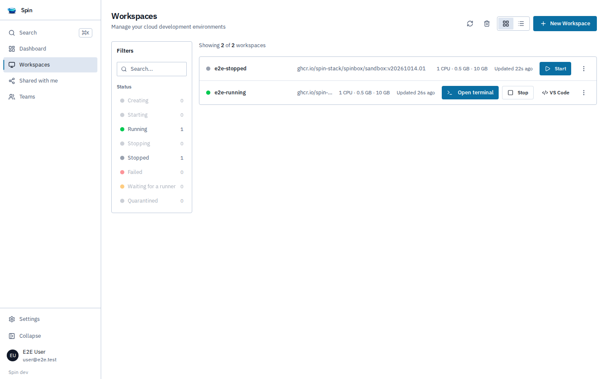
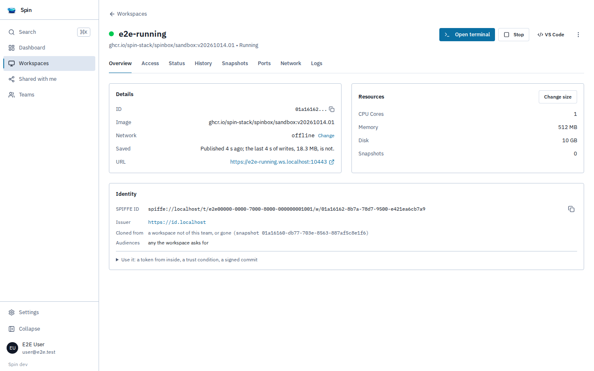

<!-- Generated by tools/refgen from spin's dashboard/e2e/site.spec.ts. Edit the source, not this file. -->

The dashboard is at `https://app.<domain>`. These screenshots are of spin v20261019.02, taken by spin's dashboard suite on its end-to-end stack - real workspaces on a real runner - each by a test that first checks the screen shows what its title says. Everything here is also in the [CLI](/reference/cli/) and the [API](/reference/api/).

## A person's workspaces

## A running workspace

